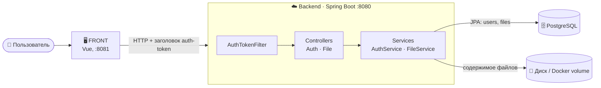
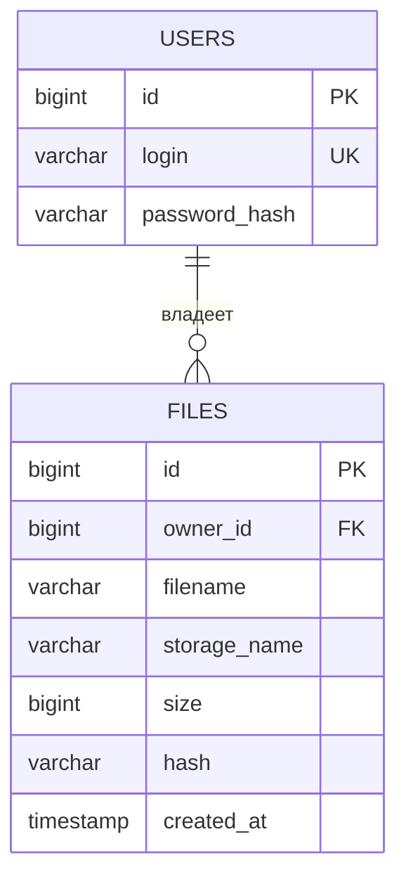
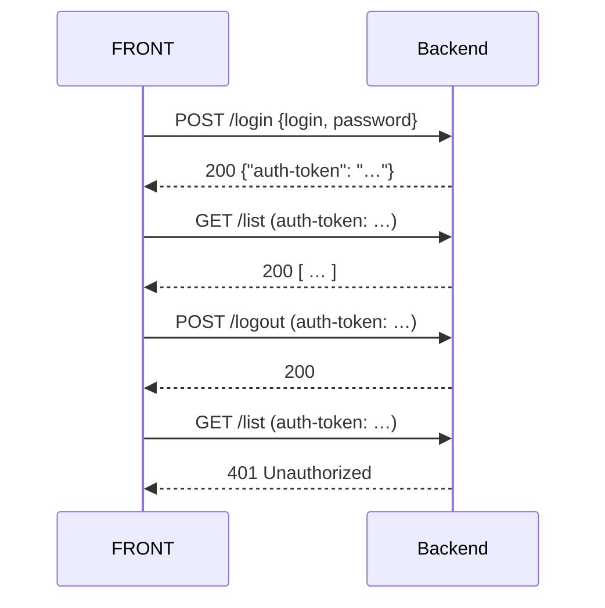
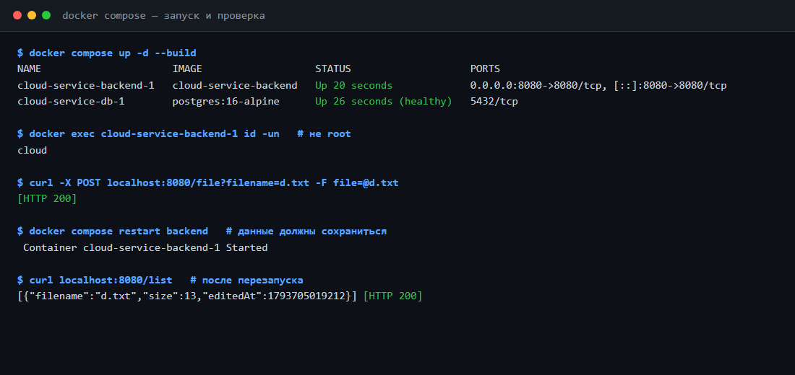
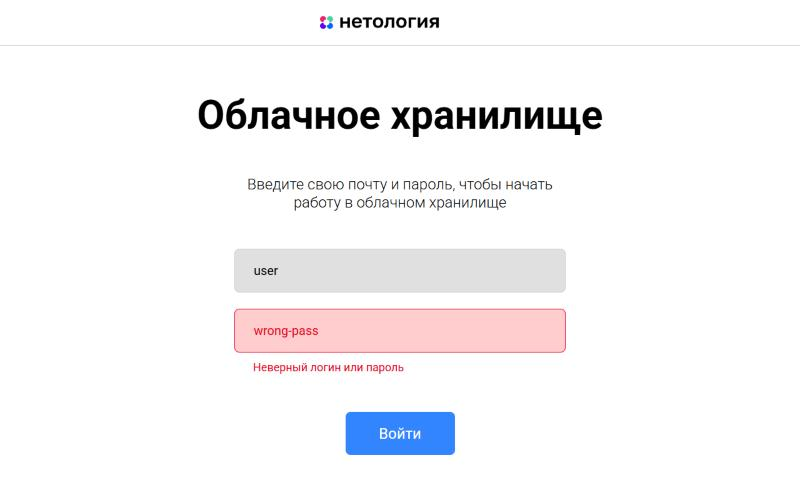
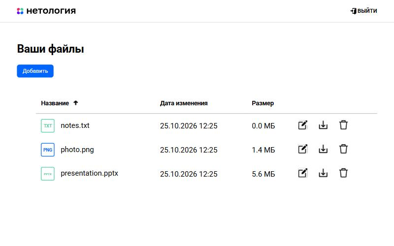
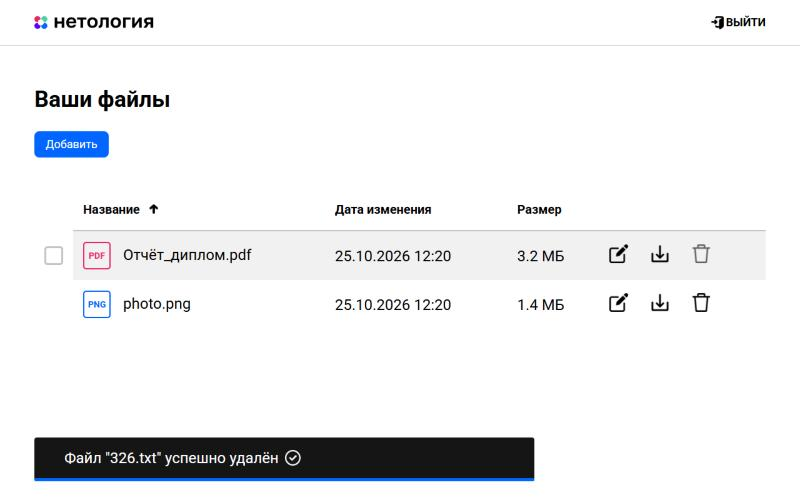
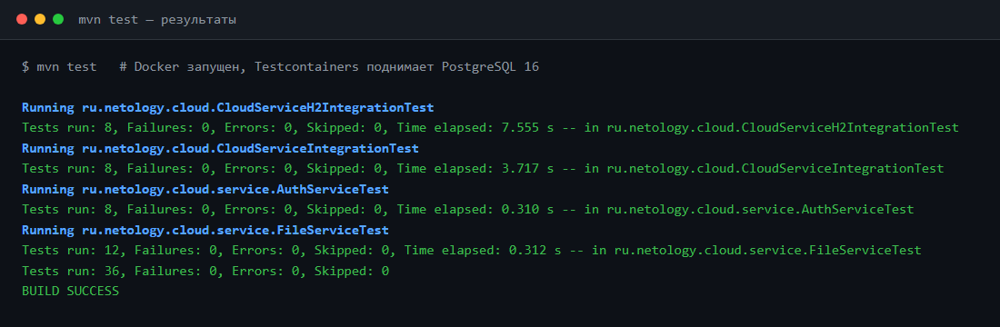
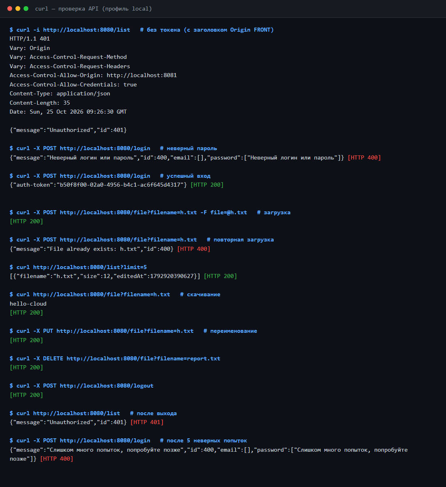

<div align="center">

# ☁️ Cloud Service

### REST-сервис облачного хранилища файлов


**Дипломная работа · Нетология · Java-разработчик**

</div>

---

## 📑 Содержание

| # | Слайд |
|---|-------|
| 1 | 🎯 Цель проекта |
| 2 | 🧱 Стек технологий |
| 3 | 🏗️ Архитектура |
| 4 | 🗄️ Хранение данных |
| 5 | 🔐 Авторизация |
| 6 | 🔌 API |
| 7 | ⚙️ Конфигурация |
| 8 | 🚀 Запуск |
| 9 | 🖥️ Подключение FRONT |
| 10 | 🧪 Тестирование |
| 11 | 📁 Структура проекта |
| 12 | ✅ Итоги |

---

## 1. 🎯 Цель проекта

Сервис, который позволяет пользователю:

- 🔑 **войти** в систему по логину и паролю;
- ⬆️ **загрузить** файл в облако;
- 📃 **посмотреть** список своих файлов;
- ✏️ **переименовать** и 🗑️ **удалить** файл;
- ⬇️ **скачать** файл обратно;
- 🚪 **выйти** — токен перестаёт действовать.

> Готовый веб-интерфейс (FRONT) работает с сервисом **без изменений**.

---

## 2. 🧱 Стек технологий

| Слой | Технология |
|------|-----------|
| Язык | Java 21 |
| Фреймворк | Spring Boot 3.5 (Web, Data JPA) |
| База данных | PostgreSQL 16 (H2 для локального профиля) |
| Хэширование паролей | BCrypt (`spring-security-crypto`) |
| Сборка | Maven |
| Контейнеры | Docker, docker-compose |
| Unit-тесты | JUnit 5 + **Mockito** |
| Интеграционные тесты | **Testcontainers** (PostgreSQL) |

---

## 3. 🏗️ Архитектура



**Слои приложения**

| Слой | Ответственность |
|------|-----------------|
| `AuthTokenFilter` | проверяет `auth-token` на каждом запросе, кроме `/login` |
| `controller` | HTTP-контракт по спецификации, единый формат ошибок |
| `service` | бизнес-логика: токены, работа с файлами |
| `repository` | Spring Data JPA |

---

## 4. 🗄️ Хранение данных

| Что | Где |
|-----|-----|
| ⚙️ Настройки | `application.yml` + переменные окружения |
| 👤 Пользователи | PostgreSQL, таблица `users` |
| 📄 Метаданные файлов | PostgreSQL, таблица `files` |
| 💾 **Содержимое файлов** | файловая система (`STORAGE_DIR`), в Docker — отдельный volume |
| 🎟️ Токены | в памяти сервиса (живут до `logout` или перезапуска) |

Большие файлы **не хранятся в БД**: на диск они пишутся под случайным именем (UUID), а в базе остаётся только ссылка.



Пара `(owner_id, filename)` уникальна — у каждого пользователя своё пространство имён.

---

## 5. 🔐 Авторизация



- Заголовок называется строго **`auth-token`** (регистр важен).
- Пароли хранятся только как **BCrypt-хэш**.
- Токен после `/logout` недействителен — дальше `401`.
- Токен истекает по TTL (по умолчанию 8 часов).
- После 5 неверных паролей вход для логина блокируется на минуту.
- Пользователь видит **только свои** файлы.

### 🛡️ Результаты ревью безопасности

| Находка | Серьёзность | Статус |
|---------|:-----------:|:------:|
| Токены не истекали | средняя | ✅ исправлено: TTL |
| Нет защиты от перебора пароля | средняя | ✅ исправлено: блокировка после N попыток |
| Демо-пользователь `admin/admin` в конфиге | средняя | ✅ убран; пароль демо-пользователя задаётся через env |
| Скачивание читало файл целиком в память (DoS) | средняя | ✅ исправлено: потоковая отдача |
| Время ответа выдавало существование логина | низкая | ✅ исправлено: проверка по хэшу-пустышке |
| Нет `X-Content-Type-Options` на скачиваемых файлах | низкая | ✅ добавлен `nosniff` |
| Контейнер работал от root | низкая | ✅ запуск от непривилегированного пользователя |
| Файл-сирота на диске при сбое записи в БД | низкая | ✅ исправлено: очистка |
| Гонка при одновременной загрузке одного имени давала 500 | низкая | ✅ исправлено: 400 |
| Имена файлов не ограничены по длине | низкая | ✅ лимит 255 символов |

**Что осознанно оставлено (для учебного проекта):**

- Токены хранятся в памяти: после перезапуска нужно войти заново, масштабирование на несколько инстансов потребует общего хранилища (например, Redis).
- Нет HTTPS: в продакшене сервис нужно ставить за TLS-терминатор (nginx и т.п.).
- Блокировка входа действует по логину, а не по IP.
- Пароль БД в `docker-compose.yml` — демонстрационный.

**Защита от типовых атак:** SQL-инъекции — Spring Data JPA с параметризованными запросами; обход путей — на диске файлы лежат под UUID, пользовательское имя в путь не попадает; доступ к чужим файлам — все запросы фильтруются по владельцу.

---

## 6. 🔌 API

| Метод | Путь | Назначение | Успех | Ошибки |
|-------|------|-----------|-------|--------|
| `POST` | `/login` | вход, возвращает `auth-token` | 200 | 400 |
| `POST` | `/logout` | выход | 200 | 401 |
| `POST` | `/file?filename=` | загрузка (`multipart`, поле `file`) | 200 | 400, 401 |
| `GET` | `/file?filename=` | скачивание | 200 | 400, 401 |
| `PUT` | `/file?filename=` | переименование, тело `{"name": "…"}` | 200 | 400, 401 |
| `DELETE` | `/file?filename=` | удаление | 200 | 400, 401 |
| `GET` | `/list?limit=` | список файлов (новые первыми) | 200 | 400, 401 |

**Формат ошибки**

```json
{ "message": "File not found: a.txt", "id": 400 }
```

**Пример ответа `/list`**

```json
[
  { "filename": "report.pdf", "size": 48213 },
  { "filename": "photo.png",  "size": 120554 }
]
```

---

## 7. ⚙️ Конфигурация

Все настройки — в [`application.yml`](src/main/resources/application.yml):

| Параметр | Переменная окружения | По умолчанию |
|----------|----------------------|--------------|
| URL базы данных | `DB_URL` | `jdbc:postgresql://localhost:5432/cloud` |
| Пользователь БД | `DB_USER` | `cloud` |
| Пароль БД | `DB_PASSWORD` | `cloud` |
| Каталог файлов | `STORAGE_DIR` | `./storage` |
| CORS-источники | `app.allowed-origins` | `localhost:8081`, `8080`, `3000` |
| Демо-пользователь | `APP_USER`, `APP_PASSWORD` | `user` / `password` |
| Время жизни токена | `TOKEN_TTL` | `8h` |
| Попыток входа до блокировки | `app.max-login-attempts` | `5` |
| Длительность блокировки | `app.lock-duration` | `1m` |

> ⚠️ Пара `user` / `password` — демонстрационная. Для реальной эксплуатации задайте `APP_USER` и `APP_PASSWORD`.

---

## 8. 🚀 Запуск

### 🐳 Вариант 1 — Docker (рекомендуется)

```bash
docker-compose up --build
```

Поднимутся PostgreSQL и backend на **http://localhost:8080**. Данные сохраняются в volume-ах `db-data` и `file-data`.

✅ **Проверено на Docker Engine 29:** образ собирается, БД проходит healthcheck, backend запускается от непривилегированного пользователя `cloud`, а загруженный файл и запись в БД сохраняются после перезапуска контейнера.



### ☕ Вариант 2 — без Docker, на встроенной H2

```bash
mvn package -DskipTests
java -jar target/cloud-service-1.0.0.jar --spring.profiles.active=local
```

### 🧑‍💻 Вариант 3 — со своим PostgreSQL

```bash
mvn spring-boot:run
```

(БД `cloud`, пользователь `cloud`, пароль `cloud` или свои значения через `DB_*`.)

---

## 9. 🖥️ Подключение FRONT

FRONT из задания лежит в папке [`front/`](front/) (Vue 3), `.env` уже настроен на backend.

```bash
cd front
npm install
npm run serve -- --port 8081
```

Открыть **http://localhost:8081**, войти: `user` / `password`.

> Порт **8080 занят backend-ом**, поэтому FRONT запускается на **8081** — этот адрес разрешён в CORS.

### 📸 Работа с FRONT

| Вход с неверным паролем | Список файлов |
|:-:|:-:|
|  |  |

**Удаление файла** (уведомление «Файл успешно удалён»):



Через интерфейс проверены: вход, ошибка входа, загрузка (4 файла), список, переименование, удаление, выход. После выхода старый токен даёт `401`.

### 🔧 Как backend подогнан под FRONT

Реальный FRONT отличается от спецификации в деталях. Backend обрабатывает все расхождения, FRONT при этом не менялся:

| Что делает FRONT | Что сделано в backend |
|------------------|-----------------------|
| Шлёт токен как `auth-token: Bearer <token>` | Префикс `Bearer ` отбрасывается |
| Переименование: тело `{"filename": "…"}`, а в спецификации `{"name": "…"}` | Принимаются оба поля |
| Колонка «Дата изменения» берёт `editedAt` из `/list` | В ответ `/list` добавлено поле `editedAt` (мс Unix) |
| Ошибку входа читает из `res.data.email` и `res.data.password` — иначе падает | Ответ `400` содержит и `message`/`id` из спецификации, и `email`/`password` |
| Распознаёт просроченный токен по `401` | CORS-фильтр стоит **перед** проверкой токена, чтобы `401` приходил с заголовками CORS и браузер его не блокировал |
| Всегда запрашивает `/list?limit=3` | Применяется `limit`, возвращаются 3 самых новых файла |

> ⚠️ **Единственное изменение в FRONT:** в `package.json` вместо `node-sass` (не собирается на Node 24 без Visual Studio) указан `sass` — Dart Sass, `sass-loader` его поддерживает. Код FRONT не менялся.

---

## 10. 🧪 Тестирование

### Unit-тесты — Mockito

| Класс | Что проверяют | Тестов |
|-------|---------------|--------|
| `AuthServiceTest` | вход, неверный пароль, неизвестный пользователь, выход, истечение токена, блокировка после неудачных попыток | 8 |
| `FileServiceTest` | загрузка, дубликат, гонка при дубликате, очистка при сбое БД, пустой файл, длинное имя, скачивание, удаление, переименование, `limit` | 12 |

### Интеграционные тесты

Один набор сквозных сценариев (`AbstractCloudApiTest`: вход → загрузка → список → скачивание → переименование → удаление → выход → `401`) запускается на двух базах:

| Класс | База | Docker |
|-------|------|:------:|
| `CloudServiceIntegrationTest` | **PostgreSQL в Testcontainers** | нужен |
| `CloudServiceH2IntegrationTest` | H2 в памяти | не нужен |

```bash
mvn test
```

> ℹ️ Если Docker не запущен, тесты Testcontainers помечаются как пропущенные и не ломают сборку.

**Итог последнего запуска:** 36 тестов, 0 падений, 0 пропущено — включая интеграционные на реальном PostgreSQL в Testcontainers.

> В `pom.xml` версия Testcontainers поднята до 1.21.4: версия 1.21.3, которую по умолчанию задаёт Spring Boot, не работает с Docker Engine 29.



### Ручная проверка через curl



Результат реального прогона приложения (профиль `local`); ниже — то же в виде таблицы:

| Шаг | Запрос | Ответ |
|-----|--------|-------|
| Без токена | `GET /list` | **401** |
| Неверный пароль | `POST /login` | **400** `Bad credentials` |
| Вход | `POST /login` | **200** `{"auth-token": "…"}` |
| Загрузка | `POST /file?filename=h.txt` | **200** |
| Повторная загрузка | `POST /file?filename=h.txt` | **400** `File already exists` |
| Список | `GET /list?limit=5` | **200** `[{"filename":"h.txt","size":12}]` |
| Скачивание | `GET /file?filename=h.txt` | **200** содержимое файла |
| Переименование | `PUT /file?filename=h.txt` | **200** |
| Удаление | `DELETE /file?filename=r.txt` | **200** |
| Выход | `POST /logout` | **200** |
| Запрос после выхода | `GET /list` | **401** |
| CORS preflight | `OPTIONS /list` (Origin `:8081`) | **200**, `Access-Control-Allow-Origin: http://localhost:8081` |

Пример команд:

```bash
TOKEN=$(curl -s -X POST localhost:8080/login \
  -H 'Content-Type: application/json' \
  -d '{"login":"user","password":"password"}' | sed 's/.*"auth-token":"\([^"]*\)".*/\1/')

curl -X POST "localhost:8080/file?filename=h.txt" -H "auth-token: $TOKEN" -F "file=@h.txt"
curl "localhost:8080/list" -H "auth-token: $TOKEN"
```

---

## 11. 📁 Структура проекта

```text
.
├── Dockerfile
├── docker-compose.yml
├── pom.xml
├── front/                 # FRONT из задания (Vue 3)
├── docs/screenshots/      # скриншоты тестов, Docker, API и FRONT
└── src
    ├── main
    │   ├── java/ru/netology/cloud
    │   │   ├── config/        # свойства, CORS, создание пользователей
    │   │   ├── controller/    # Auth, File, обработка ошибок
    │   │   ├── dto/
    │   │   ├── exception/
    │   │   ├── model/         # UserAccount, StoredFile
    │   │   ├── repository/
    │   │   ├── security/      # AuthTokenFilter
    │   │   └── service/       # AuthService, FileService
    │   └── resources/         # application.yml, application-local.yml
    └── test                   # Mockito + Testcontainers
```

---

## 12. ✅ Итоги

| Требование задания | Статус |
|--------------------|:------:|
| Spring Boot REST-сервис | ✅ |
| Методы спецификации: login, logout, upload, download, rename, delete, list | ✅ |
| Авторизация по заголовку `auth-token` | ✅ |
| CORS для FRONT | ✅ |
| Настройки в YAML | ✅ |
| Пользователи и файлы в БД | ✅ |
| Docker + docker-compose | ✅ |
| Unit-тесты на Mockito | ✅ |
| Интеграционные тесты на Testcontainers | ✅ |
| README | ✅ |

<div align="center">

### Спасибо за внимание! 🙌

</div>
